# Proyecto 1 — Chapin Red
**Curso:** LAB de Redes de Computadoras 2 — Universidad de San Carlos de Guatemala
**Estudiante:** Angel Rafael Barrios González
**Carné:** 202300733
**Protocolo de enrutamiento asignado:** EIGRP (carné impar)

---

## 1. Resumen del proyecto

Chapin Red es una organización con edificios distribuidos dentro de una misma área metropolitana. Este proyecto diseña e implementa, en Cisco Packet Tracer, una red corporativa multi-edificio con arquitectura jerárquica, segmentación por VLANs, agregación de enlaces (LACP/PAgP), enrutamiento dinámico (EIGRP), servicios DHCP centralizados y políticas de seguridad mediante ACLs.

---

## 2. Topología general

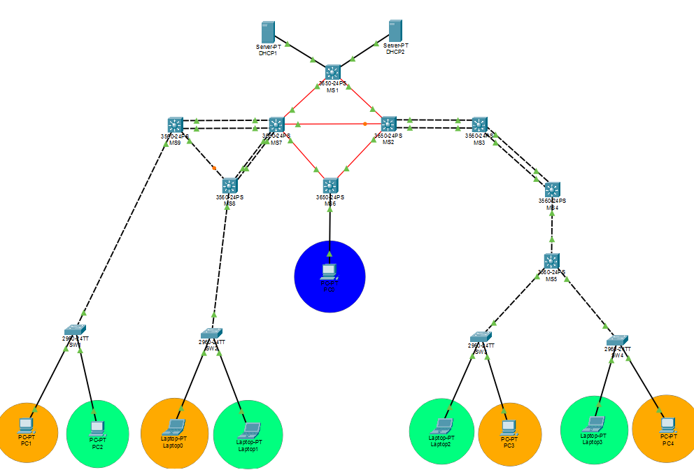


La red está compuesta por:
- **MAN (backbone):** 4 switches multicapa 3650-24PS (`MS1`, `MS7`, `MS2`, `MS6`) interconectados con fibra óptica monomodo en una malla redundante de 5 enlaces.
- **Edificio Izquierdo:** arquitectura jerárquica de 3 capas — Core (`MS9`), Distribución (`MS8`), Acceso (`SW1`, `SW2`).
- **Edificio Derecho:** `MS3`, `MS4`, `MS5` (3560-24PS), Acceso (`SW3`, `SW4`).
- **Administración:** `DHCP1` y `DHCP2` conectados a `MS1`; `PC0` conectado a `MS6`.

---

## 3. Direccionamiento IP (VLSM)

**Redes base asignadas** (X = 33, últimos 2 dígitos del carné):
- `192.188.33.0/24` — VLANs de usuario
- `10.4.33.0/24` — enlaces de enrutamiento / tránsito

### 3.1 VLSM de VLANs (192.188.33.0/24)

| VLAN | Nombre | Red/Máscara | Rango usable | Broadcast | Gateway |
|---|---|---|---|---|---|
| 10 | Naranja Edificio Izquierdo | 192.188.33.0/29 | .1 – .6 | .7 | 192.188.33.1 |
| 20 | Verde Edificio Izquierdo | 192.188.33.8/29 | .9 – .14 | .15 | 192.188.33.9 |
| 30 | Naranja Edificio Derecho | 192.188.33.16/29 | .17 – .22 | .23 | 192.188.33.17 |
| 40 | Verde Edificio Derecho | 192.188.33.24/29 | .25 – .30 | .31 | 192.188.33.25 |
| 99 | ADMIN | 192.188.33.32/29 | .33 – .38 | .39 | 192.188.33.33 |

**Asignación de hosts dentro de VLAN ADMIN:** `.33` gateway (SVI en MS1), `.34` DHCP1 (estática), `.35` DHCP2 (estática), `.36`–`.38` pool dinámico para PC0.

### 3.2 Red de tránsito para enrutamiento (10.4.33.0/24)

En vez de asignar un `/30` independiente a cada enlace físico, se optó por una **VLAN de tránsito compartida (VLAN 100)** sobre los trunks ya existentes entre los switches multicapa que realizan enrutamiento (`MS1`, `MS8`, `MS5`). Esta decisión de diseño se documenta y justifica en la sección 9.

| Switch | SVI Vlan 100 |
|---|---|
| MS1 | 10.4.33.1/29 |
| MS8 | 10.4.33.2/29 |
| MS5 | 10.4.33.3/29 |

---

## 4. VLANs y VTP

**Dominio VTP:** `ChapinRed`
**Contraseña VTP:** `ChapinRed2026`
**VTP Server:** MS1
**VTP Client:** MS2, MS3, MS4, MS5, MS6, MS7, MS8, MS9, SW1, SW2, SW3, SW4

| VLAN ID | Nombre |
|---|---|
| 10 | VLAN_Naranja_EdificioIZQ_202300733 |
| 20 | VLAN_Verde_EdificioIZQ_202300733 |
| 30 | VLAN_Naranja_EdificioDER_202300733 |
| 40 | VLAN_Verde_EdificioDER_202300733 |
| 99 | VLAN_ADMIN_202300733 |
| 100 | MAN_Transito_202300733 |

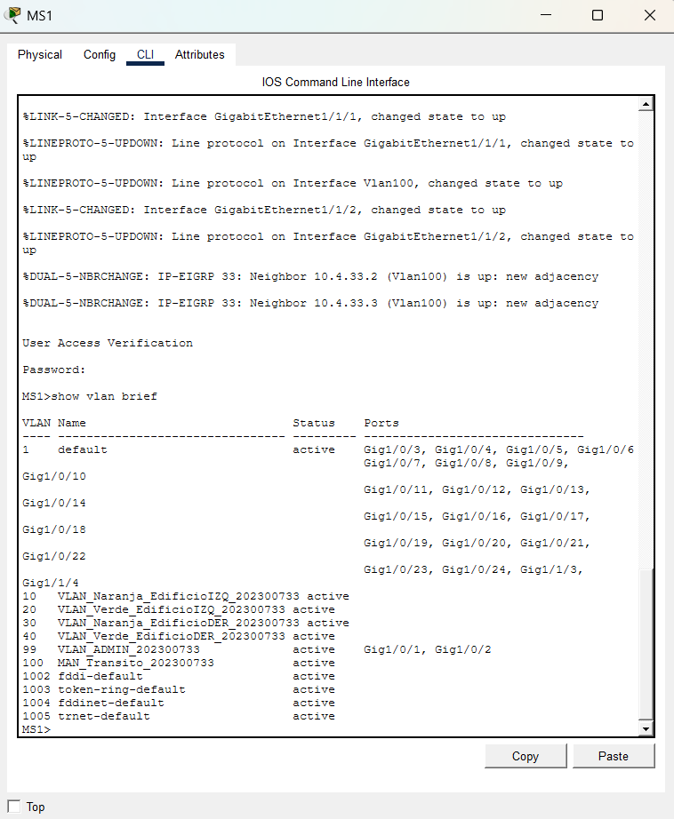

**Comandos principales:**
```
vtp domain ChapinRed
vtp password ChapinRed2026
vtp mode server        ! (solo en MS1)
vtp mode client         ! (en los otros 12 switches)

vlan 10
 name VLAN_Naranja_EdificioIZQ_202300733
```

---

## 5. Agregación de enlaces

### 5.1 LACP — Edificio Izquierdo (5 enlaces)

| Canal | Enlace | Interfaces | Modo |
|---|---|---|---|
| Po1 | MS9 ↔ MS7 | MS9: Fa0/1-2 — MS7: Gi1/0/1-2 | LACP active |
| Po2 | MS8 ↔ MS7 | MS8: Fa0/1-2 — MS7: Gi1/0/3-4 | LACP active |
| Po3 | MS9 ↔ MS8 | MS9: Fa0/3 — MS8: Fa0/3 | LACP active |

```
interface range FastEthernet0/1-2
 channel-group 1 mode active
```

### 5.2 PAgP — Edificio Derecho (3 enlaces)

| Canal | Enlace | Interfaces | Modo |
|---|---|---|---|
| Po1 | MS3 ↔ MS4 | Fa0/1-2 | PAgP desirable |
| Po2 | MS4 ↔ MS5 | Fa0/3 (MS4) — Fa0/1 (MS5) | PAgP desirable |

```
interface range FastEthernet0/1-2
 channel-group 1 mode desirable
```
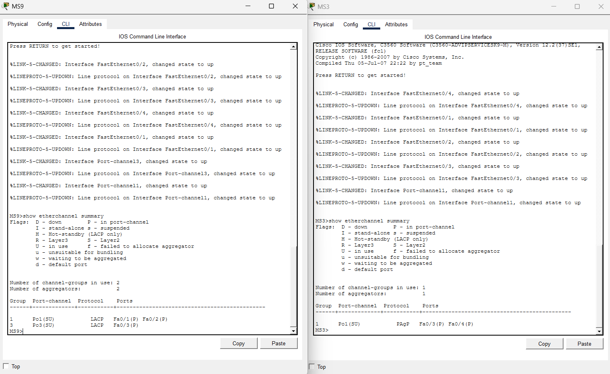

### 5.3 Prueba de tolerancia a fallos

Con un ping sostenido activo (`ping -t`), se desconectó un puerto miembro de cada canal (LACP y PAgP). El `Port-channel` permaneció `up/up` y el ping no mostró pérdida sostenida de paquetes, confirmando la redundancia de la agregación.

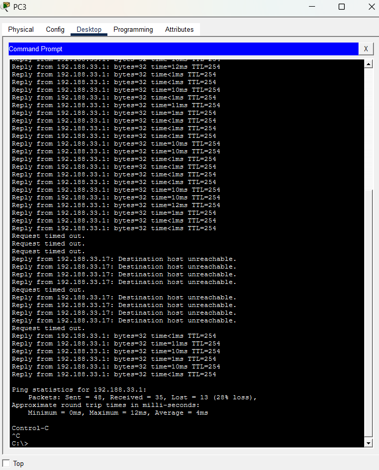

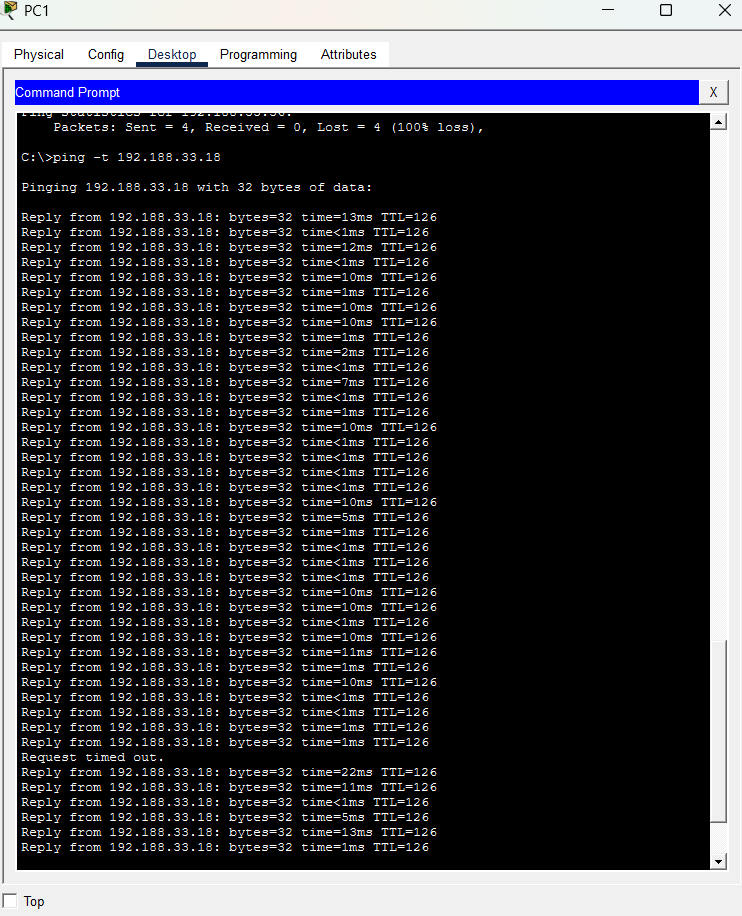

---

## 6. Spanning Tree Protocol

**Modo:** Rapid-PVST en los 13 switches
**Root primario:** MS1 (todas las VLANs)
**Root secundario:** MS7

```
spanning-tree mode rapid-pvst
spanning-tree vlan 1,10,20,30,40,99,100 root primary    ! en MS1
spanning-tree vlan 1,10,20,30,40,99,100 root secondary  ! en MS7
```

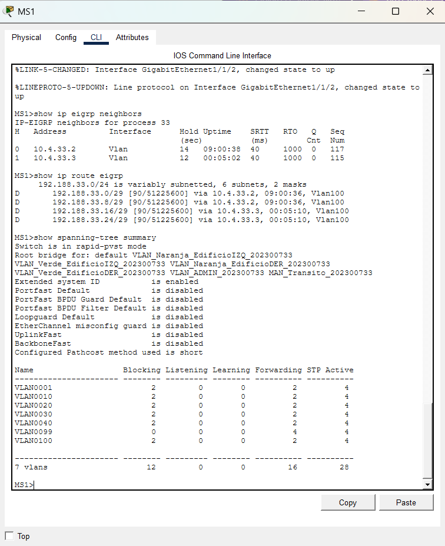

---

## 7. Enrutamiento dinámico — EIGRP

**Sistema Autónomo:** 33

**Switches que enrutan:** MS1 (VLAN 99 + tránsito), MS8 (VLAN 10, 20 + tránsito), MS5 (VLAN 30, 40 + tránsito)

```
router eigrp 33
 network 192.188.33.0 0.0.0.7
 network 192.188.33.8 0.0.0.7
 network 10.4.33.0 0.0.0.7
 no auto-summary
 passive-interface vlan 10
 passive-interface vlan 20
```

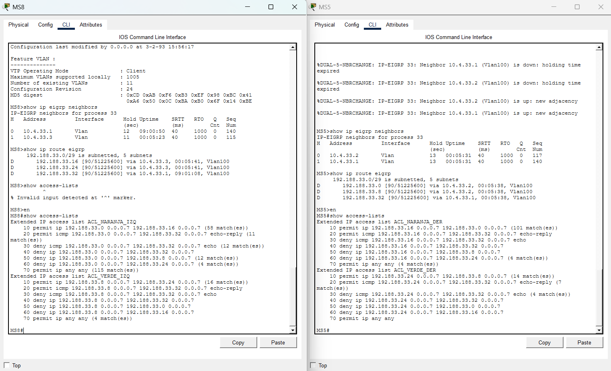
---

## 8. DHCP y DHCP Relay

| Servidor | IP | Pools que sirve |
|---|---|---|
| DHCP1 | 192.188.33.34 (estática) | Naranja Izq, Verde Izq, ADMIN |
| DHCP2 | 192.188.33.35 (estática) | Naranja Der, Verde Der |

| Pool | Gateway | Rango dinámico |
|---|---|---|
| NARANJA_IZQ | 192.188.33.1 | .2 – .6 |
| VERDE_IZQ | 192.188.33.9 | .10 – .14 |
| ADMIN | 192.188.33.33 | .36 – .38 |
| NARANJA_DER | 192.188.33.17 | .18 – .22 |
| VERDE_DER | 192.188.33.25 | .26 – .30 |

**DHCP Relay (`ip helper-address`):**
```
interface vlan 10
 ip helper-address 192.188.33.34
interface vlan 20
 ip helper-address 192.188.33.34
interface vlan 30
 ip helper-address 192.188.33.35
interface vlan 40
 ip helper-address 192.188.33.35
```
*(VLAN 99 no requiere relay: PC0 y DHCP1 comparten el mismo dominio de broadcast.)*

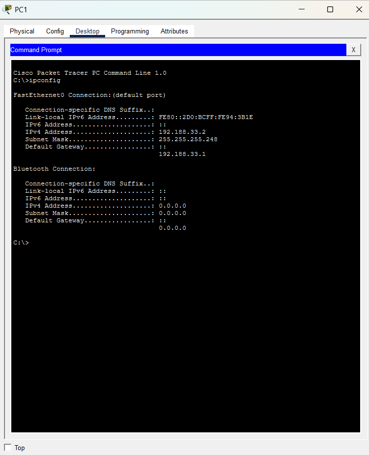

---

## 9. Listas de Control de Acceso (ACL)

**Política implementada:**
- Naranja solo se comunica con Naranja del otro edificio.
- Verde solo se comunica con Verde del otro edificio.
- ADMIN puede iniciar comunicación hacia cualquier VLAN; ninguna VLAN puede iniciar comunicación hacia ADMIN (sí puede responder si ADMIN inició).

```
ip access-list extended ACL_NARANJA_IZQ
 remark Permitir comunicacion con Naranja Derecho
 permit ip 192.188.33.0 0.0.0.7 192.188.33.16 0.0.0.7
 remark Permitir responder si ADMIN inicio el ping
 permit icmp 192.188.33.0 0.0.0.7 192.188.33.32 0.0.0.7 echo-reply
 remark Bloquear que Naranja Izq inicie trafico hacia ADMIN
 deny icmp 192.188.33.0 0.0.0.7 192.188.33.32 0.0.0.7 echo
 deny ip 192.188.33.0 0.0.0.7 192.188.33.32 0.0.0.7
 remark Bloquear hacia Verde (ambos edificios)
 deny ip 192.188.33.0 0.0.0.7 192.188.33.8 0.0.0.7
 deny ip 192.188.33.0 0.0.0.7 192.188.33.24 0.0.0.7
 permit ip any any

interface vlan 10
 ip access-group ACL_NARANJA_IZQ in
```
*(Las 4 ACL completas — ACL_NARANJA_IZQ, ACL_VERDE_IZQ, ACL_NARANJA_DER, ACL_VERDE_DER — siguen esta misma lógica, aplicadas en MS8 y MS5.)*


---

## 10. Matriz de pruebas de conectividad

| # | Origen | Destino | Resultado esperado | Resultado obtenido |
|---|---|---|---|---|
| 1 | Naranja Izq | Naranja Der | ✅ Permitido | |
| 2 | Verde Izq | Verde Der | ✅ Permitido | |
| 3 | Naranja Izq | Verde Izq | ❌ Bloqueado | |
| 4 | Naranja Der | Verde Der | ❌ Bloqueado | |
| 5 | Naranja Izq | Verde Der | ❌ Bloqueado | |
| 6 | Naranja Izq | ADMIN | ❌ Bloqueado | |
| 7 | Verde Der | ADMIN | ❌ Bloqueado | |
| 8 | ADMIN | Naranja Izq | ✅ Permitido | |
| 9 | ADMIN | Verde Der | ✅ Permitido | |
| 10 | Cualquier PC | Su gateway | ✅ Permitido | |

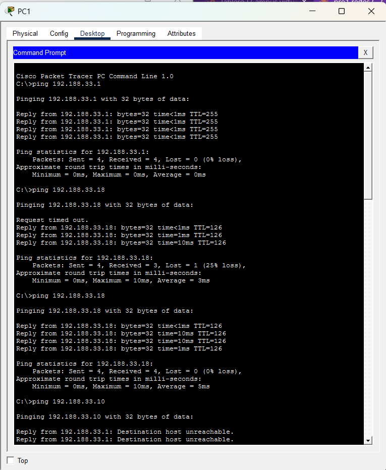

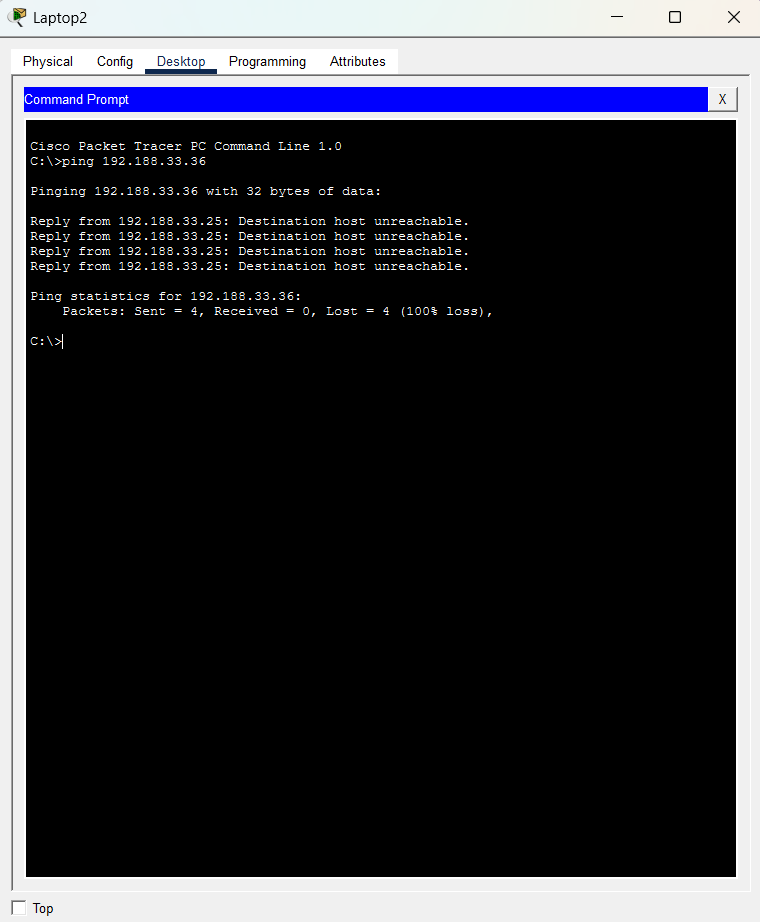

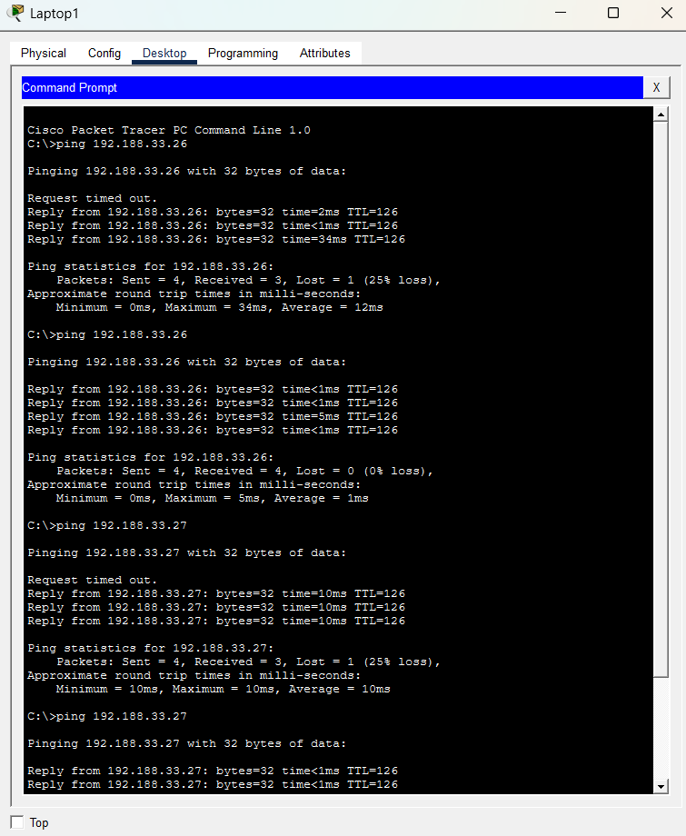

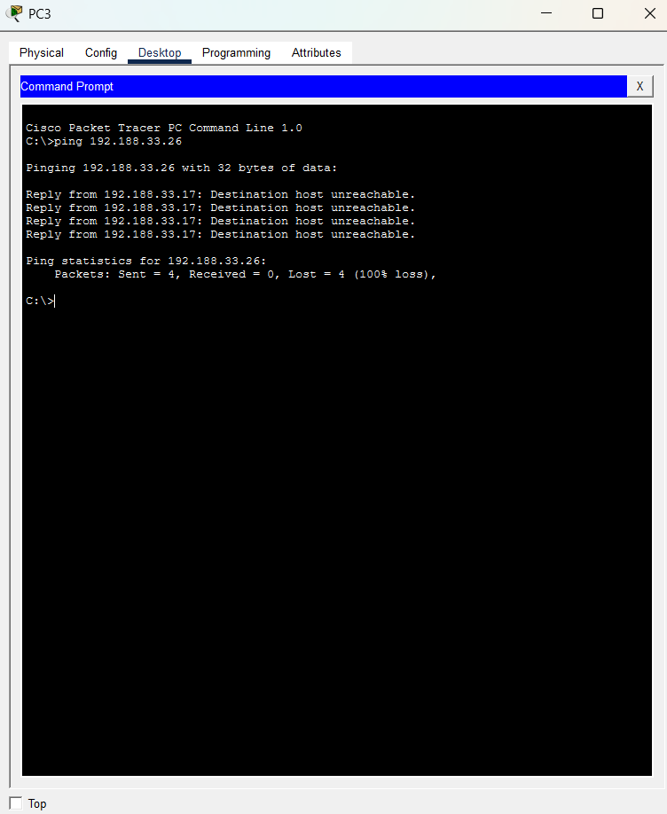

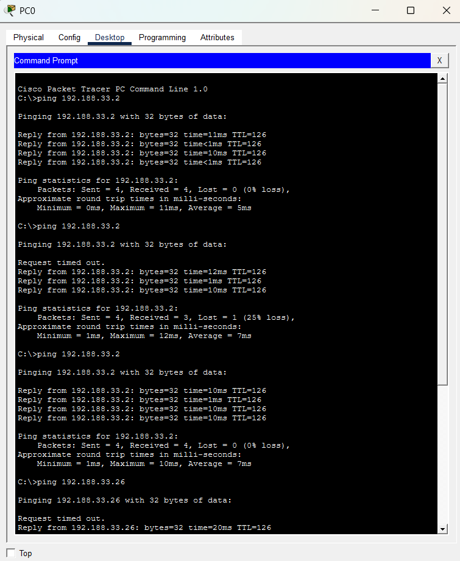

---

## 11. Decisiones de diseño justificadas

- **VLAN de tránsito (VLAN 100) en vez de múltiples `/30` independientes:** dado que todos los enlaces switch-a-switch ya estaban trunkeados (para VTP y agregación), se optó por una VLAN de tránsito compartida con SVI en los 3 switches que enrutan (MS1, MS8, MS5), en vez de convertir cada enlace físico en un puerto ruteado independiente. Esto logra el mismo resultado funcional (enrutamiento EIGRP entre edificios) con menor complejidad y sin modificar la topología de Capa 2 ya validada con Spanning Tree.
- **VLAN 100 removida de los enlaces de MS9:** `MS9` no participa en el enrutamiento (no tiene SVI), por lo que se restringió la VLAN 100 de sus Port-channel para eliminar un loop innecesario que causaba inestabilidad intermitente.
- **DHCP1 sirve también el pool de ADMIN:** por estar en la misma VLAN 99 que PC0, no requiere DHCP Relay para ese pool.

---

## 12. Comandos principales utilizados (resumen)

| Categoría | Comando |
|---|---|
| VTP | `vtp domain`, `vtp password`, `vtp mode` |
| VLANs | `vlan`, `name` |
| Trunking | `switchport trunk encapsulation dot1q`, `switchport mode trunk` |
| Acceso | `switchport mode access`, `switchport access vlan` |
| LACP | `channel-group X mode active` |
| PAgP | `channel-group X mode desirable` |
| STP | `spanning-tree mode rapid-pvst`, `spanning-tree vlan X root primary/secondary` |
| SVI | `interface vlan X`, `ip address`, `no shutdown` |
| Enrutamiento | `ip routing`, `router eigrp 33`, `network`, `no auto-summary` |
| DHCP Relay | `ip helper-address` |
| ACL | `ip access-list extended`, `permit`/`deny`, `ip access-group ... in` |

---

## 13. Conclusiones

El desarrollo del proyecto Chapin Red permitió aplicar de forma práctica e integrada los conceptos fundamentales de una red corporativa multi-edificio: desde el diseño de direccionamiento IP con VLSM, pasando por la segmentación lógica con VLANs y VTP, hasta la implementación de mecanismos de alta disponibilidad como LACP y PAgP.

Uno de los mayores aprendizajes fue comprender que el diseño en papel (Fase 0) no siempre se traduce de forma directa a la implementación, y que es normal encontrarse con limitaciones del hardware simulado (como la disponibilidad de módulos de fibra o la cantidad de puertos Gigabit en ciertos switches) que obligan a ajustar decisiones sobre la marcha, documentando y justificando cada cambio.

La configuración de Spanning Tree Protocol en una topología con múltiples enlaces redundantes (tanto en la malla de la MAN como dentro de cada edificio) dejó claro por qué es indispensable este protocolo en redes con redundancia: sin una elección de puente raíz explícita y bien planificada, el árbol de expansión puede converger de forma inestable, afectando temporalmente la conectividad incluso cuando la configuración de base es correcta.

El enrutamiento dinámico con EIGRP demostró ser una solución robusta y de rápida convergencia para interconectar las distintas subredes de la organización, mientras que la combinación de DHCP centralizado con DHCP Relay permitió automatizar la asignación de direcciones IP sin necesidad de configuración manual en los dispositivos finales, cumpliendo con el requisito de no usar direccionamiento estático.

Finalmente, la implementación de las listas de control de acceso reforzó la importancia de diseñar políticas de seguridad específicas y bien fundamentadas, en especial al resolver el caso de tráfico unidireccional de la VLAN de Administración, donde fue necesario diferenciar entre solicitudes y respuestas ICMP para lograr el comportamiento exacto que pedía el enunciado.

En conjunto, este proyecto fortaleció mi comprensión práctica sobre el diseño, la implementación y la resolución de problemas en redes empresariales jerárquicas, reforzando la importancia de la planificación, la documentación ordenada y la verificación metódica en cada etapa del proceso.